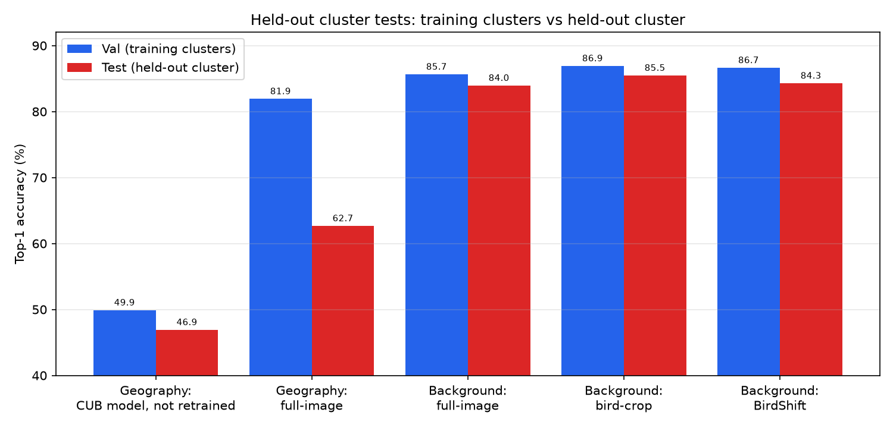
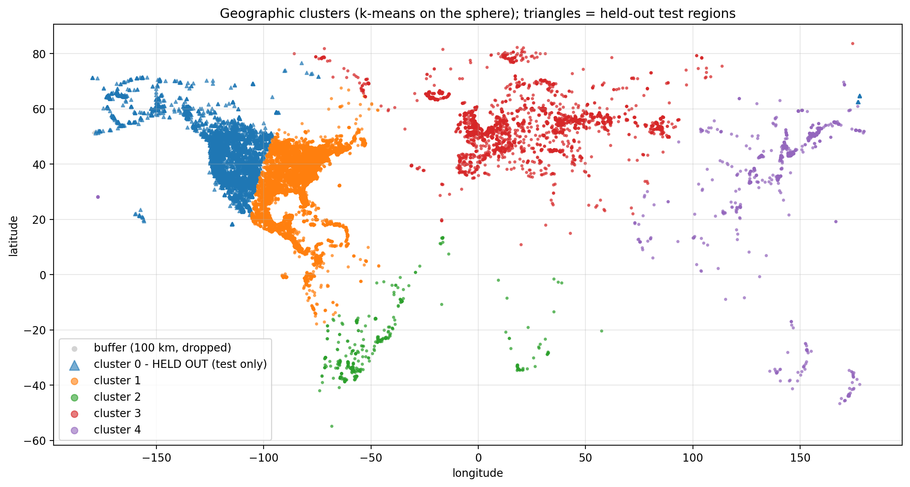
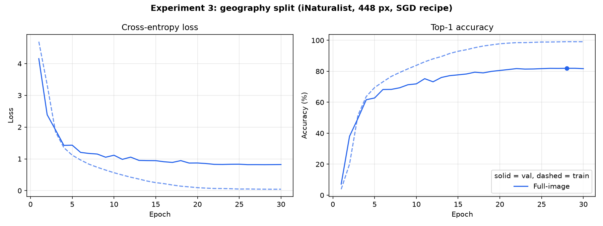
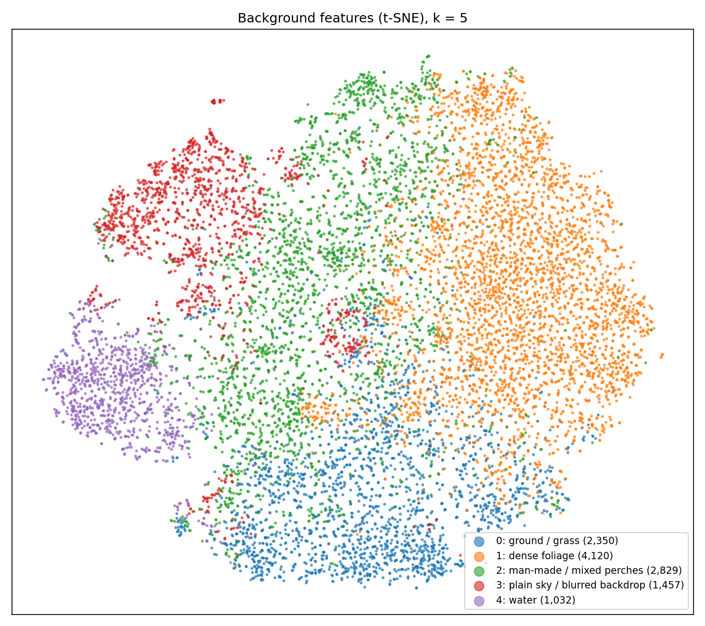
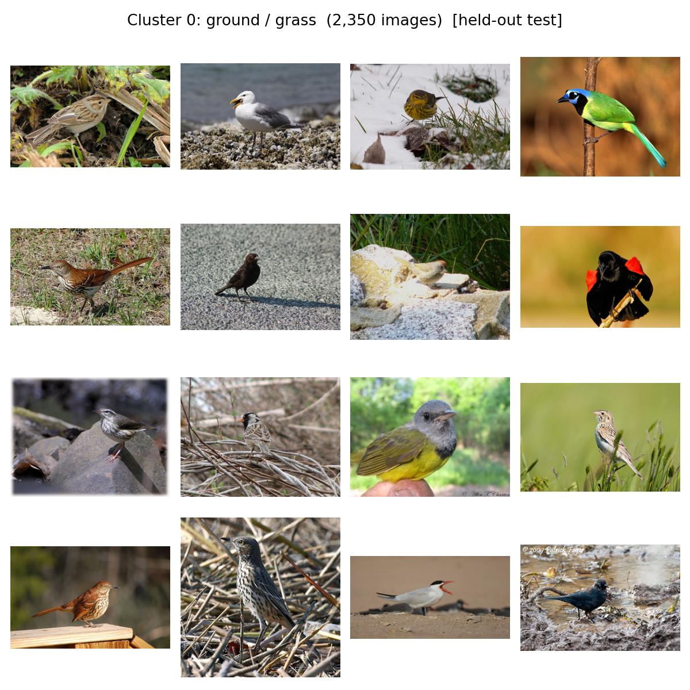
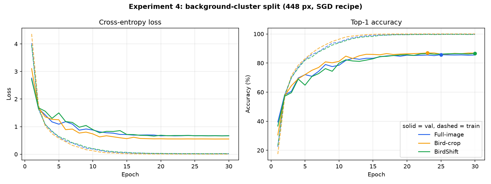

# BirdShift

Context-debiased fine-grained bird recognition under background, geography and long-tail shift. DSE-312 Computer Vision course project.


**Team:** Shafwan Safi (24003), Ankit Kumar (24045), Agastya Bhanu (24025)

Bird classifiers often learn the scene instead of the bird: a heron is "the bird near water". We measure how much a ResNet-50 relies on that context, train a model that relies on it less (BirdShift), test on held-out backgrounds and held-out regions, and compare fixes for long-tailed training data.

**Contents:** [Results at a glance](#results-at-a-glance) · [Exp 1: synthetic background shift](#experiment-1-synthetic-background-shift) · [Training recipe](#training-recipe-matching-the-published-resnet-50) · [Exp 2: class imbalance](#experiment-2-class-imbalance) · [Exp 3: geography](#experiment-3-held-out-geographic-region) · [Exp 4: held-out background](#experiment-4-held-out-background-cluster) · [Setup and running](#setup-and-running) · [Problems and fixes](#problems-we-hit-and-how-we-fixed-them) · [References](#references)

---

## Results at a glance

| Experiment | Question | Main result |
|---|---|---|
| 1. Synthetic background shift (CUB val, 900) | Does accuracy drop when the background is blurred or replaced? | Full-image drops up to 1.7 pp; BirdShift up to 0.4 pp; bird-crop is unaffected but needs a box at test time |
| Training recipe (CUB test, 5,794) | Can we match the published ResNet-50 (84.5%)? | **84.55%** with torchvision weights + SGD; timm's default weights cost 7.8 pp |
| 2. Long-tail, 10:1 (CUB val, 900) | Which fix helps rare classes most? | Logit-adjusted CE: 53.0% → **62.3%**, tail 23% → 50% |
| 3. Held-out region (iNaturalist, 18,953) | Train on other regions, test on western North America | 81.9% → **62.7%** (−19.3 pp); 11.7 pp of that is a different species mix |
| 4. Held-out background (CUB, 2,350) | Train on 4 background clusters, test on "ground / grass" | All three models lose under 2.5 pp; bird-crop best (85.5%), BirdShift +0.3 pp over full-image |



Unless stated, numbers are from one training run (seed 42). On the 900-image CUB val split a 1 pp gap is 9 images. All raw numbers are in [`results/metrics/`](results/metrics/): per-epoch training logs (`cub_<run>_training.csv`), test accuracy (`test_accuracy.csv`), held-out cluster accuracy (`split_shift_accuracy.csv`) and per-image predictions.

---

## Experiment 1: synthetic background shift

| Model | Training input | Test input | Box needed at test? |
|---|---|---|---|
| **Full-image** | Whole photo | Whole photo | No |
| **Bird-crop** | Bounding-box crop, square-padded | Bounding-box crop | **Yes** |
| **BirdShift** | Whole photo; with probability 0.5 everything outside the bird's box is Gaussian-blurred (radius 22) | Whole photo | No |

Each model is evaluated on the val images unchanged, with the background blurred, and with the background replaced by neutral gray (gray, not another photo, so no second bird or habitat leaks in).


Top-1 on CUB val (900 images), AdamW recipe:

| Model | 224 px original | blur | replace | 448 px original | blur | replace |
|---|---|---|---|---|---|---|
| Full-image | **78.33%** | 77.33% | 76.67% | 79.44% | 79.22% | 78.33% |
| Bird-crop | 77.89% | 77.89% | 77.89% | **81.33%** | **81.33%** | **81.33%** |
| BirdShift | 78.22% | **78.78%** | **77.78%** | 79.67% | 79.56% | 79.44% |

<p>


</p>

- The full-image model loses accuracy whenever the background changes, so part of what it learned is the scene.
- BirdShift needs no box at test time, matches the full-image model on normal photos, and drops least under both shifts.
- Bird-crop never sees the background, so it can't be affected, but it needs a box for every test image.
- These shifts are synthetic. Experiment 4 tests a real unseen background type.

<details>
<summary><b>Macro-F1 and training curves</b></summary>

| Model | 224 px original | blur | replace | 448 px original | blur | replace |
|---|---|---|---|---|---|---|
| Full-image | **0.776** | 0.765 | 0.758 | 0.784 | 0.783 | 0.774 |
| Bird-crop | 0.769 | 0.769 | 0.769 | **0.807** | **0.807** | **0.807** |
| BirdShift | 0.772 | **0.779** | **0.771** | 0.787 | 0.787 | 0.786 |


Dots mark the best val epoch. Bird-crop overfits most (99% train accuracy). The 224 px full-image log covers only epochs 21 to 30 ([problem 7](#problems-we-hit-and-how-we-fixed-them)).

</details>

---

## Training recipe: matching the published ResNet-50

Fine-grained papers report about **84.5%** CUB test accuracy for a plain ResNet-50 at 448 px [6, 16]. Our first 448 px model reached 80.4%, so we changed one thing at a time, chose on val, and evaluated test once.

| Run | Optimizer | Pretrained weights | Train crop | LR schedule | Epochs | Val | Test (5,794) |
|---|---|---|---|---|---|---|---|
| `baseline_448` | AdamW 1e-4 | timm `a1_in1k` | RandomResizedCrop | constant | 30 | 79.33% | 80.38% |
| `recipe_adamw` | AdamW 1e-4 | timm `a1_in1k` | Resize 512 + RandomCrop 448 | cosine [13] | 50 | 79.44% | 80.74% |
| `recipe_sgd` | SGD 0.01, head ×10 | timm `a1_in1k` | Resize 512 + RandomCrop 448 | cosine | 50 | 75.00% | 76.08% |
| `recipe_sgd_tv` | SGD 0.01, head ×10 [14] | torchvision `tv_in1k` [15] | Resize 512 + RandomCrop 448 | cosine | 50 | **84.00%** | **83.88%** |
| `final_sgd_tv` | same, trained on train + val (5,994), last epoch | | | | 50 | n/a | **84.55%** |


- **Pretrained weights were the biggest factor (+7.8 pp).** timm's default weights come from a heavy-augmentation BCE recipe [11] and transfer worse than the classic torchvision weights, in line with Kornblith et al. [12].
- This recipe (SGD, cosine, 448 px, torchvision weights) is used for Experiments 3 and 4.
- The 84.55% model is on the [v1.0 release](https://github.com/Shafwansafi06/BirdShift/releases/tag/v1.0) (96 MB): `gh release download v1.0 -R Shafwansafi06/BirdShift -p birdshift_resnet50_448_cub.pth`, then load it into `BirdResNet(200, pretrained=False)`; inputs are Resize(512) + CenterCrop(448) + ImageNet normalisation.

---

## Experiment 2: class imbalance

CUB is nearly balanced, so the training split is cut to an exponential long tail with a 10:1 ratio: class at rank *r* keeps `n_max · 10^(−r/199)` images, 5,094 → 2,039 images (26 down to 3 per class). Class order is a seeded shuffle, because CUB labels are sorted by taxonomy. Val stays balanced. Head / medium / tail are the top, middle and bottom thirds of classes by training count.

| Method | Top-1 | Macro-F1 | Head | Medium | Tail |
|---|---|---|---|---|---|
| Standard CE | 53.00% | 0.477 | **80.20%** | 56.39% | 23.18% |
| Weighted sampler (prob ∝ 1/n<sub>c</sub>) | 59.78% | 0.571 | 70.31% | **66.56%** | 42.72% |
| Class-balanced CE, β = 0.999 [3] | 59.33% | 0.563 | 72.35% | 63.28% | 42.72% |
| **Logit-adjusted CE**, τ = 1 [5] | **62.33%** | **0.597** | 73.38% | 64.26% | **49.67%** |
| CE + post-hoc logit adjustment (no retraining) | 59.67% | 0.567 | 74.74% | 63.61% | 41.06% |


- Plain CE is good on common classes and poor on rare ones (80% vs 23%).
- Logit-adjusted CE is best overall (+9.3 pp) and more than doubles tail accuracy. τ was fixed at 1, not tuned.
- Post-hoc adjustment lifts the CE model to 59.7% with no retraining.

<details>
<summary><b>Training curves</b></summary>


</details>

---

## Experiment 3: held-out geographic region

*Split built by Ankit Kumar ([PR #3](https://github.com/Shafwansafi06/BirdShift/pull/3), [#4](https://github.com/Shafwansafi06/BirdShift/pull/4)); details in [`data/splits/geography/`](data/splits/geography/).*

56,700 iNaturalist research-grade photos (CC0 / CC-BY / CC-BY-NC) of 156 CUB species, clustered by location with k-means on the sphere. Cluster 0, western North America, is held out for test; a 100 km buffer around it is dropped, and no species + observer outing spans train and val. Train 32,083 · val 5,664 · test 18,953. iNaturalist has no bounding boxes, so only the full-image model runs here.



| Model | Val, training regions (5,664) | Test, held-out west (18,953) | Drop |
|---|---|---|---|
| CUB model (`final_sgd_tv`, 84.55% on CUB test), not retrained | 49.91% (balanced 49.73%) | 46.93% (balanced 48.48%) | 3.0 pp |
| Trained on this split (`geo_sgd_tv`, best epoch 28 / 30) | **81.94%** (balanced 77.84%) | **62.68%** (balanced 73.08%) | **19.3 pp** (balanced 4.8 pp) |

Balanced = mean per-species accuracy.

- Moving from CUB photos to iNaturalist photos costs the CUB model about 35 pp, far more than the regional shift.
- **Most of the 19.3 pp drop is a change in species mix.** Reweighting per-species val accuracy to the test species counts gives 70.25%: 11.7 pp is label shift and 7.6 pp is the region itself. Balanced accuracy falls only 4.8 pp.
- The most common test species are western birds rare in the training regions (2 to 7 val images each): Rhinoceros Auklet 11.6% (370 test images), Pelagic Cormorant 26.6%, Brewer Blackbird 31.8%, Heermann Gull 37.1%.



---

## Experiment 4: held-out background cluster

*Split built by Agastya Bhanu ([PR #5](https://github.com/Shafwansafi06/BirdShift/pull/5)); details in [`data/splits/background/`](data/splits/background/).*

All 11,788 CUB images are clustered by background: ResNet-50 features of the image with the bird's box masked out, k-means with k = 5. The "ground / grass" cluster is held out for test (2,350 images, 196 species); the other four give train 8,015 · val 1,423. Because these are CUB images with boxes, all three models run. The split ignores CUB's official train/test split, so every model here is retrained from ImageNet weights.

<p>


</p>

Left: t-SNE of background features, by cluster. Right: sample images from the held-out "ground / grass" cluster. Galleries for every cluster, the choice of k and the test-species counts are in [`results/figures/background_clusters/`](results/figures/background_clusters/).

| Model | Best epoch | Val, training backgrounds (1,423) | Test, ground / grass (2,350) | Drop |
|---|---|---|---|---|
| Full-image | 25 / 30 | 85.66% (balanced 85.34%) | 83.96% (balanced 82.93%) | 1.7 pp |
| Bird-crop | 23 / 30 | **86.93%** (balanced 86.81%) | **85.49%** (balanced 83.01%) | 1.4 pp |
| BirdShift | 30 / 30 | 86.65% (balanced 86.30%) | 84.30% (balanced 82.60%) | 2.4 pp |

- An unseen background type costs every model under 2.5 pp, far less than the 19.3 pp geographic drop.
- Bird-crop is best on test (+1.5 pp, 36 images over full-image). BirdShift is +0.3 pp (8 images) over full-image, within one-seed noise.
- 43 test species have fewer than 5 images, so balanced accuracy is noisy.



---

## Setup and running

```bash
python3 -m venv .venv && source .venv/bin/activate
pip install torch torchvision timm pandas scikit-learn pillow matplotlib requests
```

Tested with Python 3.10, PyTorch 2.14 (CUDA 13), torchvision 0.29, timm 1.0 on an RTX 3090. Get CUB-200-2011 from the [Caltech data repository](https://data.caltech.edu/records/65de6-vp158) and extract it to `data/raw/CUB_200_2011/`. Run everything from the repository root with `PYTHONPATH=src`.

<details>
<summary><b>Commands for every experiment</b></summary>

```bash
# Experiment 1 (224 px; add --image-size 448 --amp --run-name <mode>_448 for 448 px)
for m in full crop birdshift; do python scripts/train.py --mode $m --epochs 30; done
python scripts/evaluate_shift.py --split val          # results/background_shift/

# Training recipe (84.55% CUB test)
python scripts/train.py --mode full --epochs 50 --image-size 448 --amp --workers 8 \
    --train-aug fg --scheduler cosine --optimizer sgd --lr 0.01 --head-lr-mult 10 \
    --weights resnet50.tv_in1k --train-split trainval --run-name final_sgd_tv
cp checkpoints/final_sgd_tv/last.pth checkpoints/final_sgd_tv/best.pth
python scripts/eval_test.py final_sgd_tv

# Experiment 2
for b in none sampler cb la; do
  python scripts/train.py --mode full --epochs 30 --imbalance-ratio 10 --balance $b --run-name longtail_${b/none/ce}
done
python scripts/evaluate_longtail.py --split val       # also reports post-hoc logit adjustment

# Shared recipe for Experiments 3 and 4
R="--epochs 30 --image-size 448 --amp --workers 12 --train-aug fg --scheduler cosine \
   --optimizer sgd --lr 0.01 --head-lr-mult 10 --weights resnet50.tv_in1k"

# Experiment 3 (download images first: scripts/geography/download_inat.py -> data/raw/inat_geo)
M=data/splits/geography/geography_clusters.csv
python scripts/train.py --manifest $M --mode full $R --run-name geo_sgd_tv
python scripts/eval_test.py geo_sgd_tv final_sgd_tv --manifest $M --splits val test

# Experiment 4
M=data/splits/background/background_clusters.csv
for m in full crop birdshift; do python scripts/train.py --manifest $M --mode $m $R --run-name bg_${m}_sgd_tv; done
python scripts/eval_test.py bg_full_sgd_tv bg_crop_sgd_tv bg_birdshift_sgd_tv --manifest $M --splits val test

# Figures and checks
python scripts/plot_results.py
for t in tests/test_*.py; do python $t; done
```

Each run writes `checkpoints/<run>/best.pth` and `last.pth` (not in git) and `results/metrics/cub_<run>_training.csv`. `python scripts/train.py --help` lists every flag.

</details>

<details>
<summary><b>Repository layout</b></summary>

```
src/birdshift/
  datasets/cub.py          CUBDataset (official or manifest split; full / crop / birdshift), long-tail subsampling
  datasets/manifest.py     ManifestDataset for iNaturalist manifests
  models/resnet.py         BirdResNet (timm ResNet-50 + 200-way head)
  transforms/background.py background blur / replace, SquarePad
  training/trainer.py      train_one_epoch (optional mixed precision)
scripts/                   train.py, eval_test.py, evaluate_shift.py, evaluate_longtail.py, plot_results.py,
                           geography/ (iNaturalist download + clustering), background/ (background clustering)
data/splits/               geography and background split manifests with their own READMEs
results/                   metrics, per-image predictions, figures
tests/                     runnable checks
```

</details>

---

## Problems we hit and how we fixed them

<details>
<summary><b>13 problems</b></summary>

| # | Problem | Fix |
|---|---|---|
| 1 | Bird-crop stuck at 40%: crops were stretched to a square. | Pad to square with gray before resizing, add augmentation: 40.3% → **77.9%**. |
| 2 | Two evaluation scripts could silently disagree. | `scripts/audit_evaluators.py`: 0 tensor and 0 prediction mismatches. |
| 3 | Background replacement with another photo can leak a second bird or habitat. | Replace with flat neutral gray. |
| 4 | BirdShift checkpoints overwrote the crop folder. | Each mode gets its own folder; crop `best.pth` was never touched. |
| 5 | `--suppression-prob` was parsed but never used. | Passed to the dataset (default was already 0.5, results unaffected). |
| 6 | BirdShift checkpoint refused to load with full-image preprocessing. | Model name and preprocessing mode kept separate in `evaluate_shift.py`. |
| 7 | Full-image run stopped at epoch 20; early log lost on resume. | Resumed to epoch 30 (78.33%); curve starts at epoch 21. |
| 8 | System Python: NumPy 1.x vs 2.2.6 crash. | Everything runs in `.venv`. |
| 9 | CUB too balanced to test imbalance methods. | Built a seeded 10:1 long-tail training split. |
| 10 | Training log and evaluation differ by one image. | GPU nondeterminism on a near-tie; tables use evaluation-script numbers. |
| 11 | 4 pp below the published ResNet-50 at 448 px. | timm `a1_in1k` weights were the cause; torchvision weights + SGD → **84.55%**. |
| 12 | Geography manifest had photos with conflicting species labels and duplicates. | 7 conflicting photos removed, 5 duplicates merged; uniqueness asserted. |
| 13 | Background clustering gave different cluster ids on rerun. | Assignment uses saved centroids (99.07% agreement); committed CSV is canonical. |

</details>

---

## Roadmap

- [x] Full-image, bird-crop and BirdShift; synthetic background shift
- [x] Long-tail comparison including logit adjustment
- [x] Recipe matching the published ResNet-50 (84.55%)
- [x] Held-out region (Exp 3) and held-out background cluster (Exp 4)
- [ ] Rerun Experiments 1 and 2 with the SGD recipe
- [ ] Multiple seeds and paired significance tests

## References

1. C. Wah, S. Branson, P. Welinder, P. Perona, S. Belongie. *The Caltech-UCSD Birds-200-2011 Dataset.* Caltech, 2011.
2. K. He, X. Zhang, S. Ren, J. Sun. *Deep Residual Learning for Image Recognition.* CVPR 2016.
3. Y. Cui, M. Jia, T.-Y. Lin, Y. Song, S. Belongie. *Class-Balanced Loss Based on Effective Number of Samples.* CVPR 2019.
4. K. Xiao, L. Engstrom, A. Ilyas, A. Madry. *Noise or Signal: The Role of Image Backgrounds in Object Recognition.* ICLR 2021.
5. A. K. Menon, S. Jayasumana, A. S. Rawat, H. Jain, A. Veit, S. Kumar. *Long-Tail Learning via Logit Adjustment.* ICLR 2021.
6. Z. Yang, T. Luo, D. Wang, Z. Hu, J. Gao, L. Wang. *Learning to Navigate for Fine-grained Classification.* ECCV 2018.
7. P. Micikevicius et al. *Mixed Precision Training.* ICLR 2018.
8. I. Loshchilov, F. Hutter. *Decoupled Weight Decay Regularization.* ICLR 2019.
9. J. Deng, W. Dong, R. Socher, L.-J. Li, K. Li, L. Fei-Fei. *ImageNet: A Large-Scale Hierarchical Image Database.* CVPR 2009.
10. R. Wightman. *PyTorch Image Models (timm).* GitHub, 2019.
11. R. Wightman, H. Touvron, H. Jégou. *ResNet Strikes Back: An Improved Training Procedure in timm.* NeurIPS 2021 Workshop.
12. S. Kornblith, J. Shlens, Q. V. Le. *Do Better ImageNet Models Transfer Better?* CVPR 2019.
13. I. Loshchilov, F. Hutter. *SGDR: Stochastic Gradient Descent with Warm Restarts.* ICLR 2017.
14. I. Sutskever, J. Martens, G. Dahl, G. Hinton. *On the Importance of Initialization and Momentum in Deep Learning.* ICML 2013.
15. A. Paszke et al. *PyTorch: An Imperative Style, High-Performance Deep Learning Library.* NeurIPS 2019 (torchvision ResNet-50 weights).
16. Z. Li, Y. Yang, X. Liu, F. Zhou, S. Wen, W. Xu. *Dynamic Computational Time for Visual Attention.* ICCV 2017 Workshops.
17. G. Van Horn et al. *The iNaturalist Species Classification and Detection Dataset.* CVPR 2018.
