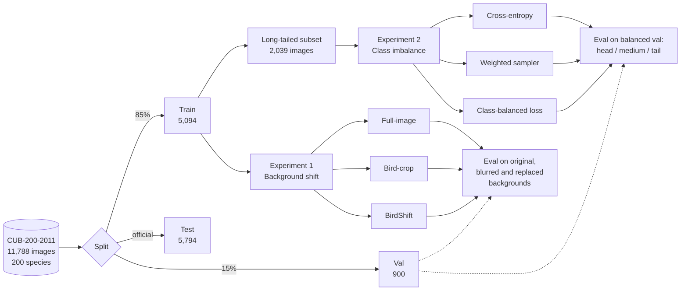
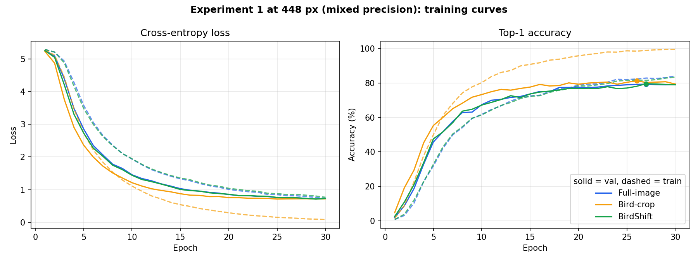
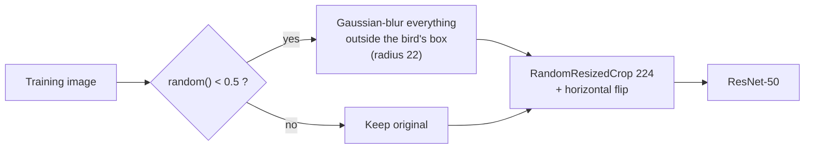
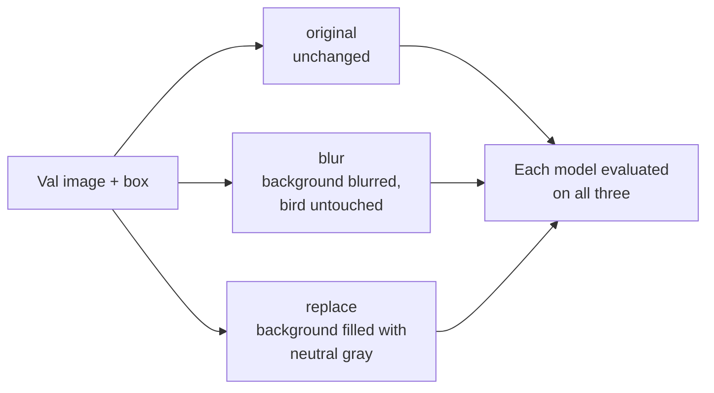
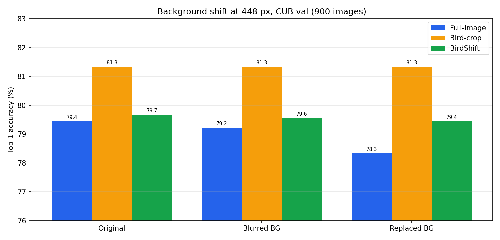
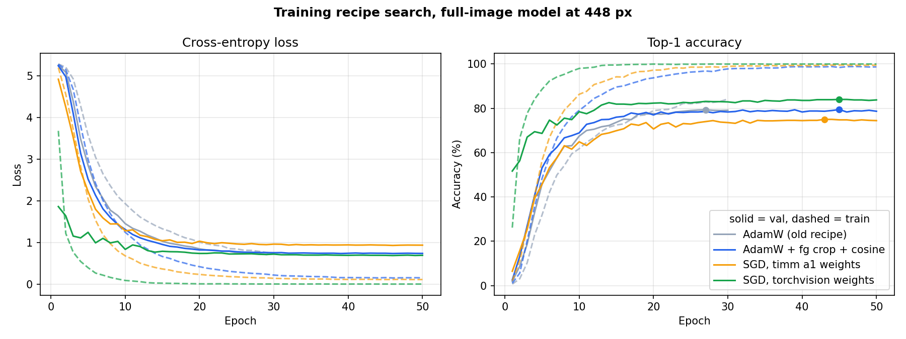
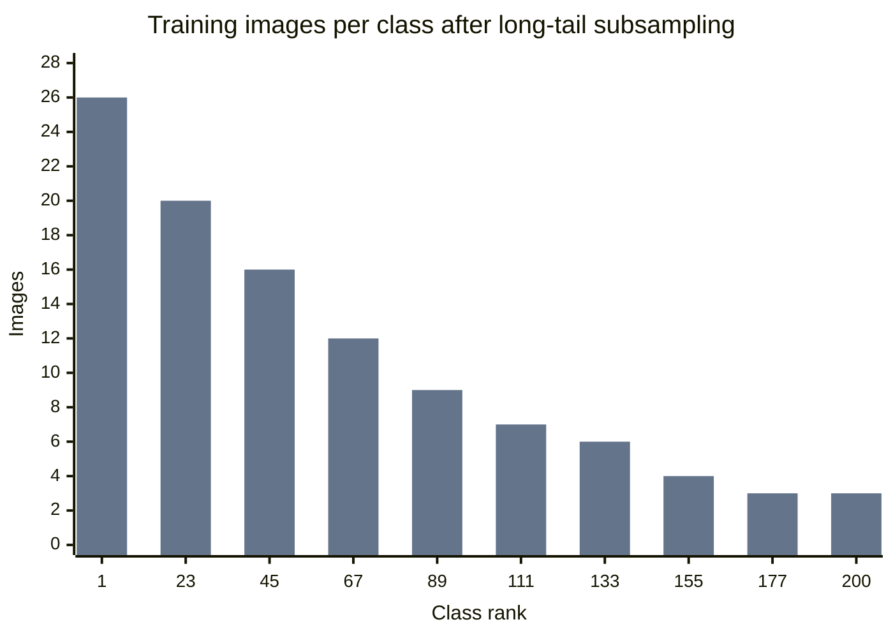
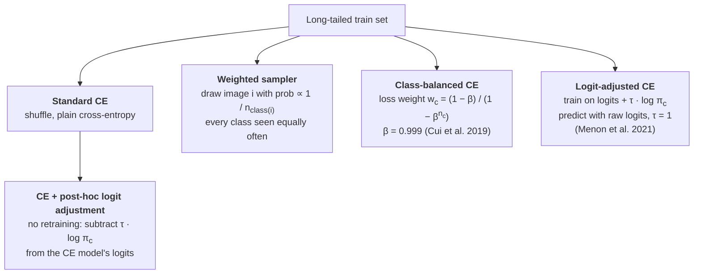
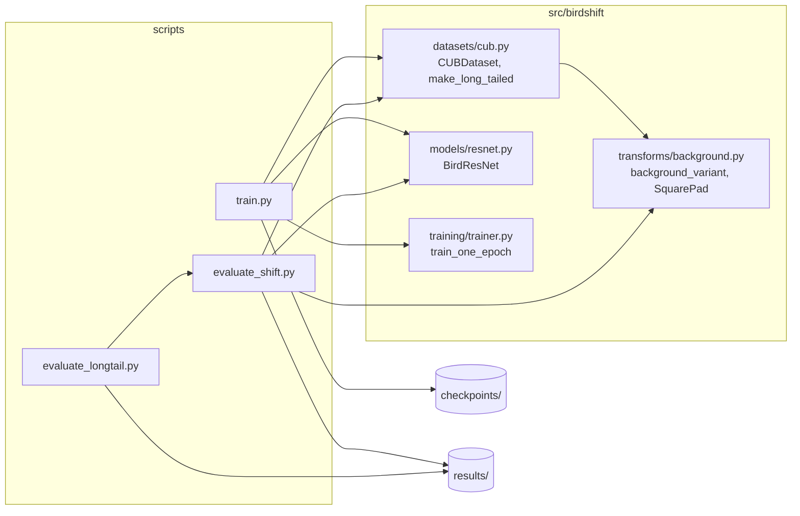

# BirdShift

Robust fine-grained bird classification under background shift and class imbalance, on CUB-200-2011.


Bird classifiers often learn shortcuts from the scene around the bird (water, sky, branches) rather than the bird itself. A heron is "the bird near water". This project measures how much a ResNet-50 depends on that context, trains a model that depends on it less, and studies how to handle rare classes when the training data is long-tailed.

**Contents:** [Overview](#overview) · [Best runs](#best-runs) · [Experiment 1: background shift](#experiment-1-background-shift) · [Experiment 2: class imbalance](#experiment-2-class-imbalance) · [Setup](#setup) · [Running the code](#running-the-code) · [Problems and fixes](#problems-we-hit-and-how-we-fixed-them) · [Repository layout](#repository-layout) · [Roadmap](#roadmap)

---

## Overview



All models share the same backbone (ImageNet-pretrained ResNet-50 from `timm`, with a 200-way head), optimiser (AdamW, lr 1e-4), batch size (64), 30 epochs and validation split (stratified, `random_state=42`). The main runs use 224 px images; Experiment 1 was repeated at 448 px with mixed precision.

---

## Best runs

Best checkpoint of each run, chosen by validation accuracy. "Val (training log)" is the number logged during training. "Val (re-evaluated)" comes from the evaluation scripts and is the number used in every results table.

| Run | Training data | Best epoch | Val (training log) | Val (re-evaluated) | Checkpoint |
|---|---|---|---|---|---|
| Full-image | 5,094 images | 30 / 30 | 78.33% | **78.33%** | `checkpoints/baseline/best.pth` |
| Bird-crop | 5,094 images | 24 / 25 | 77.89% | **77.89%** | `checkpoints/crop/best.pth` |
| BirdShift | 5,094 images | 29 / 30 | 78.33% | **78.22%** | `checkpoints/birdshift/best.pth` |
| Long-tail, standard CE | 2,039 images | 30 / 30 | 53.00% | **53.00%** | `checkpoints/longtail_ce/best.pth` |
| Long-tail, weighted sampler | 2,039 images | 30 / 30 | 59.89% | **59.78%** | `checkpoints/longtail_sampler/best.pth` |
| Long-tail, class-balanced CE | 2,039 images | 29 / 30 | 59.33% | **59.33%** | `checkpoints/longtail_cb/best.pth` |
| Long-tail, logit-adjusted CE | 2,039 images | 29 / 30 | 62.33% | **62.33%** | `checkpoints/longtail_la/best.pth` |
| Full-image, 448 px | 5,094 images | 27 / 30 | 79.33% | **79.44%** | `checkpoints/baseline_448/best.pth` |
| Bird-crop, 448 px | 5,094 images | 26 / 30 | 81.33% | **81.33%** | `checkpoints/crop_448/best.pth` |
| BirdShift, 448 px | 5,094 images | 27 / 30 | 79.67% | **79.67%** | `checkpoints/birdshift_448/best.pth` |
| Full-image, 448 px, SGD recipe | 5,094 images | 45 / 50 | 84.00% | **84.00%** | `checkpoints/recipe_sgd_tv/best.pth` |
| Full-image, 448 px, SGD recipe, final | 5,994 images (train + val) | 50 / 50 | n/a | n/a, **84.55% test** | `checkpoints/final_sgd_tv/last.pth` |

The long-tail runs see 60% fewer training images than the first three, so their absolute accuracy should only be compared with each other.

### Training curves


Dots mark the best validation epoch. The bird-crop model fits its training set almost perfectly (99% train accuracy, train loss near 0.1) while validation flattens at about 78%, so it overfits the most. BirdShift trains more slowly than the full-image model because half its training images have their background blurred, but it reaches the same validation accuracy. The full-image log only covers epochs 21 to 30 (see [problem 7](#problems-we-hit-and-how-we-fixed-them)).


With only 2,039 images the gap between train and validation loss is much larger. Standard CE ends with the highest validation loss. Logit-adjusted CE ends with the lowest validation loss and the highest accuracy.



At 448 px all three models finish 1 to 3.5 points above their 224 px versions. The bird-crop model gains the most, because a larger input shows more feather detail when the bird fills the frame.

---

## Experiment 1: background shift

### The three models

| Model | What it sees in training | What it sees at test time | Needs a bounding box at test time? |
|---|---|---|---|
| **Full-image** | Whole photo, `RandomResizedCrop` + flip | Whole photo, `Resize(256)` + `CenterCrop(224)` | No |
| **Bird-crop** | Bounding-box crop, square-padded, flip / rotate / colour jitter | Bounding-box crop | **Yes** |
| **BirdShift** | Whole photo; half the time the background is blurred first | Whole photo, same as full-image | No |

### How BirdShift training works



The bounding box is only used to build the training augmentation. At test time BirdShift takes a plain photo, exactly like the full-image model.

### How the test images are shifted



Gray is used for `replace` instead of another photo so that no second bird or species-specific habitat leaks into the image.


### Results

Top-1 accuracy on the 900 validation images:


| Model | Original | Blurred BG | Replaced BG | Change (blur) | Change (replace) |
|---|---|---|---|---|---|
| Full-image | **78.33%** | 77.33% | 76.67% | −1.00 pp | −1.67 pp |
| Bird-crop | 77.89% | 77.89% | 77.89% | 0.00 pp | 0.00 pp |
| **BirdShift** | 78.22% | **78.78%** | **77.78%** | **+0.56 pp** | −0.44 pp |

<details>
<summary><b>Macro-F1 for the same runs</b></summary>

| Model | Original | Blurred BG | Replaced BG |
|---|---|---|---|
| Full-image | **0.776** | 0.765 | 0.758 |
| Bird-crop | 0.769 | 0.769 | 0.769 |
| BirdShift | 0.772 | **0.779** | **0.771** |

</details>

**Takeaways**

- The full-image model loses accuracy whenever its background is changed, so part of what it learned is the scene, not the bird.
- The bird-crop model can't be affected by the background because it never sees it. The price is that it needs a bounding box for every test image.
- BirdShift needs no box at test time, matches the full-image model on normal photos (−0.11 pp), and holds up better under both shifts.

These are controlled, synthetic shifts. They show the model leans less on background context; they don't yet show it generalises to new real-world habitats.

### Repeated at 448 px

Fine-grained bird papers usually train at 448×448 rather than 224×224 (Yang et al. 2018 report 84.5% for a plain ResNet-50 at 448 px). We retrained all three models at 448 px with float16 mixed precision (`--image-size 448 --amp`), keeping every other setting the same. Each 448 px run took about 12 minutes on an RTX 3090 (about 25 s per epoch).



| Model | Original | Blurred BG | Replaced BG | Change (blur) | Change (replace) | Gain over 224 px (original) |
|---|---|---|---|---|---|---|
| Full-image | 79.44% | 79.22% | 78.33% | −0.22 pp | −1.11 pp | +1.11 pp |
| Bird-crop | **81.33%** | **81.33%** | **81.33%** | 0.00 pp | 0.00 pp | +3.44 pp |
| **BirdShift** | 79.67% | 79.56% | 79.44% | **−0.11 pp** | **−0.23 pp** | +1.45 pp |

<details>
<summary><b>Macro-F1 at 448 px</b></summary>

| Model | Original | Blurred BG | Replaced BG |
|---|---|---|---|
| Full-image | 0.784 | 0.783 | 0.774 |
| Bird-crop | **0.807** | **0.807** | **0.807** |
| BirdShift | 0.787 | 0.787 | 0.786 |

</details>

- Higher resolution helps every model, but with our AdamW recipe the numbers stay below the 84.5% reported in the literature. The next section closes that gap.
- The same pattern holds as at 224 px: the full-image model drops most when the background is replaced (−1.11 pp, 10 images), BirdShift barely moves (−0.23 pp, 2 images), and BirdShift is ahead of the full-image model in all three conditions.
- At 448 px the bird-crop model is the most accurate, but it still needs a bounding box at test time.

### Matching the published ResNet-50 number

Fine-grained papers report about **84.5%** test accuracy for a plain ResNet-50 at 448 px on CUB [6]. Our 448 px full-image model reached 80.38% on test, so we compared training recipes one change at a time. All four runs use the full-image model at 448 px with mixed precision. The recipe was picked on val; the test split was evaluated once at the end.

| Run | Optimizer | Pretrained weights | Train crop | LR schedule | Epochs | Val | Test (5,794) |
|---|---|---|---|---|---|---|---|
| Old recipe (`baseline_448`) | AdamW 1e-4 | timm `a1_in1k` | RandomResizedCrop | constant | 30 | 79.33% | 80.38% |
| `recipe_adamw` | AdamW 1e-4 | timm `a1_in1k` | Resize 512 + RandomCrop 448 | cosine | 50 | 79.44% | 80.74% |
| `recipe_sgd` | SGD 0.01, head ×10 | timm `a1_in1k` | Resize 512 + RandomCrop 448 | cosine | 50 | 75.00% | 76.08% |
| `recipe_sgd_tv` | SGD 0.01, head ×10 | torchvision `tv_in1k` | Resize 512 + RandomCrop 448 | cosine | 50 | **84.00%** | **83.88%** |
| `final_sgd_tv` | same as above, trained on train + val (5,994 images), last epoch | | | | 50 | n/a | **84.55%** |



- **The pretrained weights were the biggest factor (+7.8 pp test).** timm's default `resnet50` weights (`a1_in1k`) were trained with a heavy augmentation and BCE-loss recipe, and they fine-tune worse on CUB than the classic torchvision weights that the published baselines used.
- Changing the crop, schedule and epoch count with AdamW adds only 0.4 pp. SGD helps only together with the torchvision weights.
- Training on all 5,994 official training images instead of holding 900 back adds the last 0.7 pp and **matches the published 84.5%**. That run has no held-out val, so it uses the last epoch, and it is reported on test only.
- Per-run test numbers are in `results/metrics/test_accuracy.csv`. The background-shift and long-tail experiments above still use the old AdamW recipe; rerunning them with this recipe is on the roadmap.

---

## Experiment 2: class imbalance

CUB is almost balanced (about 25 to 30 training images per species), so balancing methods would have little to fix on the original data. Instead the training split is cut down to an exponential long-tail with a 10:1 ratio between the most and least common class. The validation set stays balanced.



Class at rank *r* keeps `n_max · 10^(−r/199)` images (at least 1): 5,094 → 2,039 images, 26 down to 3 per class. The class order is a seeded random shuffle, because CUB labels are sorted by taxonomy and otherwise the "tail" would be a single bird family.

### The methods



π<sub>c</sub> is the fraction of training images in class *c*. τ was fixed at 1, the value used in the paper, and was not tuned on the validation set.

Head, medium and tail are the top, middle and bottom thirds of classes ranked by how many training images they kept.

### Results


| Method | Top-1 | Macro-F1 | Head | Medium | Tail |
|---|---|---|---|---|---|
| Standard CE | 53.00% | 0.477 | **80.20%** | 56.39% | 23.18% |
| Weighted sampler | **59.78%** | **0.571** | 70.31% | **66.56%** | **42.72%** |
| Class-balanced CE | 59.33% | 0.563 | 72.35% | 63.28% | 42.72% |
| **Logit-adjusted CE** | **62.33%** | **0.597** | 73.38% | 64.26% | **49.67%** |
| CE + post-hoc logit adj. | 59.67% | 0.567 | 74.74% | 63.61% | 41.06% |

**Takeaways**

- Plain cross-entropy is good on common classes and poor on rare ones (80% vs 23%).
- Every balancing method raises overall accuracy by 6 to 9 points, mostly by helping rare classes, and every one gives up some head-class accuracy.
- **Logit-adjusted CE is the best method here:** highest overall accuracy (+9.3 pp over CE), highest macro-F1 and the best tail accuracy (49.7%, more than double CE). It also loses less on head classes than the weighted sampler.
- **Post-hoc logit adjustment needs no retraining** and still lifts the CE model from 53.0% to 59.7%, matching the sampler and class-balanced loss while keeping the most head-class accuracy (74.7%).
- Sampler and class-balanced loss are within 0.5 pp of each other (about 4 images), so this run doesn't separate them.

> **Caveat for both experiments.** Every number above comes from one training run (seed 42) on the 900-image validation split. A 1 pp gap is 9 images. Multi-seed runs and paired significance tests are still to do. The official CUB test split has been used once, only for the training-recipe comparison in [Matching the published ResNet-50 number](#matching-the-published-resnet-50-number), after the recipe had been chosen on val.

---

## Problems we hit and how we fixed them

| # | Problem | How we noticed | Fix |
|---|---|---|---|
| 1 | **Bird-crop model stuck at 40% accuracy.** Bounding-box crops were resized straight to 224×224, which stretched tall and wide birds out of shape. | Crop model far below the full-image model (40.3% vs 78%). | Pad each crop to a square with gray (`SquarePad`) before resizing, and add flip / rotation / colour-jitter augmentation. Accuracy went 40.3% → 70.1% → **77.9%**. |
| 2 | **Two evaluation scripts could silently disagree.** `evaluate.py` and `evaluate_shift.py` build their inputs differently. | Needed to trust that "original" in the shift experiment equals normal evaluation. | `scripts/audit_evaluators.py` compares both pipelines image by image: 0 tensor mismatches, 0 prediction mismatches, identical 78.33%. Saved in `results/metrics/evaluation_audit.json`. |
| 3 | **Background replacement could leak information.** Pasting the bird onto another photo's background can bring in a second bird or a species-typical habitat. | Design review of the `replace` condition. | Replace the background with flat neutral gray instead of a donor image. |
| 4 | **BirdShift checkpoints written into the crop folder.** A leftover line in `train.py` sent every non-`full` run to `checkpoints/crop/`, so BirdShift overwrote `crop/last.pth`. | A checkpoint in `checkpoints/crop/` had `mode = birdshift` stored inside it. | Removed the override so each mode gets its own folder; recovered checkpoints moved to `checkpoints/recovery/`. The crop model's `best.pth` was never touched. |
| 5 | **`--suppression-prob` did nothing.** The flag was parsed but never passed to the dataset. | Reading `train.py` while checking the folder bug. | Passed through to `CUBDataset`. Existing results are unaffected because the dataset default was already 0.5. |
| 6 | **BirdShift model refused to load for evaluation.** The loader checks that a checkpoint's stored mode matches the requested one. BirdShift is stored as `birdshift` but is evaluated with full-image preprocessing. | `ValueError: Checkpoint mode='birdshift', requested mode='full'`. | `evaluate_shift.py` now keeps the model name (checked against the checkpoint) separate from the preprocessing mode. |
| 7 | **Baseline improved after more epochs, but early log lost.** The first full-image run stopped at epoch 20 (77.56%). | Validation accuracy still rising at epoch 20. | Resumed with `--resume` to epoch 30 (**78.33%**). Only epochs 21 to 30 of the log survived, which is why its curve starts at epoch 21. |
| 8 | **PyTorch crashed under the system Python.** | `A module that was compiled using NumPy 1.x cannot be run in NumPy 2.2.6`. | All work runs inside the project virtual environment (`.venv`). |
| 9 | **CUB is too balanced to test imbalance methods.** About 25 to 30 training images per species. | Balancing would have little to correct. | Built an exponential long-tail training split (10:1). Classes are shuffled with a fixed seed first, because CUB labels are sorted by taxonomy and the tail would otherwise be one bird family. |
| 10 | **Training log and evaluation differ by one image** (59.89% vs 59.78%, 78.33% vs 78.22%). | Comparing logs with evaluation output. | Most likely GPU nondeterminism (`cudnn.benchmark` is on during training) flipping one near-tie prediction. All results tables use the evaluation-script numbers. |
| 11 | **Stuck about 4 points below the published ResNet-50 baseline at 448 px.** | 80.4% test against 84.5% in the literature. | Ablated one change at a time. The cause was timm's default `a1_in1k` weights; switching to torchvision weights with SGD, cosine LR and a 10× head learning rate gave 83.9%, and training on train + val gave **84.55%**. |

---

## Setup

```bash
python3 -m venv .venv && source .venv/bin/activate
pip install torch torchvision timm pandas scikit-learn pillow matplotlib
```

Tested with Python 3.10, PyTorch 2.14 (CUDA 13), torchvision 0.29, timm 1.0 on an RTX 3090.

<details>
<summary><b>Download the dataset</b></summary>

CUB-200-2011 is available from the [Caltech data repository](https://data.caltech.edu/records/65de6-vp158). It is not tracked in git.

```bash
mkdir -p data/raw && cd data/raw
wget -O CUB_200_2011.tgz "https://data.caltech.edu/records/65de6-vp158/files/CUB_200_2011.tgz?download=1"
tar -xzf CUB_200_2011.tgz && cd ../..
```

Expected layout:

```
data/raw/CUB_200_2011/
├── images/
├── images.txt
├── image_class_labels.txt
├── train_test_split.txt
└── bounding_boxes.txt
```

</details>

---

## Running the code

Run everything from the repository root.

<details open>
<summary><b>Experiment 1: train and evaluate</b></summary>

```bash
PYTHONPATH=src python scripts/train.py --mode full      --epochs 30   # checkpoints/baseline/
PYTHONPATH=src python scripts/train.py --mode crop      --epochs 30   # checkpoints/crop/
PYTHONPATH=src python scripts/train.py --mode birdshift --epochs 30   # checkpoints/birdshift/

PYTHONPATH=src python scripts/evaluate_shift.py --split val           # results/background_shift/

# Same experiment at 448 px with mixed precision
for m in full crop birdshift; do
  PYTHONPATH=src python scripts/train.py --mode $m --epochs 30 --image-size 448 --amp \
      --workers 8 --run-name ${m/full/baseline}_448
done
PYTHONPATH=src python scripts/evaluate_shift.py --split val --output results/background_shift_448 \
    --full-checkpoint checkpoints/baseline_448/best.pth --crop-checkpoint checkpoints/crop_448/best.pth \
    --birdshift-checkpoint checkpoints/birdshift_448/best.pth
```

The evaluation script reads the image size from each checkpoint.

```bash
# Recipe that matches the published ResNet-50 number (84.55% test)
PYTHONPATH=src python scripts/train.py --mode full --epochs 50 --image-size 448 --amp --workers 8 \
    --train-aug fg --scheduler cosine --optimizer sgd --lr 0.01 --head-lr-mult 10 \
    --weights resnet50.tv_in1k --train-split trainval --run-name final_sgd_tv
cp checkpoints/final_sgd_tv/last.pth checkpoints/final_sgd_tv/best.pth
PYTHONPATH=src python scripts/eval_test.py final_sgd_tv        # top-1 on the official test split
```

Drop `--train-split trainval` to keep the 900 val images held out (`recipe_sgd_tv`).

</details>

<details open>
<summary><b>Experiment 2: train and evaluate</b></summary>

```bash
for b in none sampler cb la; do
  PYTHONPATH=src python scripts/train.py --mode full --epochs 30 \
      --imbalance-ratio 10 --balance $b --run-name longtail_${b/none/ce}
done

PYTHONPATH=src python scripts/evaluate_longtail.py --split val        # results/longtail/
```

`evaluate_longtail.py` also reports post-hoc logit adjustment on the standard-CE checkpoint, so it needs no extra training. Three 224 px runs fit on one 24 GB GPU at the same time.

</details>

<details>
<summary><b>All <code>train.py</code> options</b></summary>

| Flag | Default | Meaning |
|---|---|---|
| `--mode` | `full` | `full`, `crop` or `birdshift` |
| `--suppression-prob` | `0.5` | BirdShift: probability of blurring a training image's background |
| `--imbalance-ratio` | `1` | Long-tail training split, max/min class size (1 = original data) |
| `--balance` | `none` | `none` (cross-entropy), `sampler` (WeightedRandomSampler), `cb` (class-balanced loss), `la` (logit-adjusted loss) |
| `--cb-beta` | `0.999` | β for class-balanced loss |
| `--la-tau` | `1.0` | τ for logit-adjusted loss |
| `--image-size` | `224` | Training and evaluation resolution; stored in the checkpoint |
| `--amp` | off | float16 mixed precision with `channels_last` (about 2× less memory) |
| `--optimizer` | `adamw` | `adamw` or `sgd` (Nesterov) |
| `--weight-decay` | `0.01` / `1e-4` | Default depends on the optimizer |
| `--momentum` | `0.9` | SGD momentum |
| `--scheduler` | `none` | `none` or `cosine` (stepped once per epoch) |
| `--head-lr-mult` | `1` | Learning-rate multiplier for the new 200-class layer |
| `--train-aug` | `rrc` | `rrc` (RandomResizedCrop) or `fg` (Resize size·8/7 + RandomCrop) |
| `--weights` | `resnet50` | timm pretrained weights, e.g. `resnet50.tv_in1k` |
| `--train-split` | `train` | `trainval` also trains on the 900 val images (use `last.pth`) |
| `--run-name` | by mode | Folder under `checkpoints/` and name of the training log |
| `--resume` | | Continue from a `last.pth`; `--epochs` is the total, not extra |
| `--epochs` | `20` | |
| `--batch-size` | `64` | |
| `--lr` | `1e-4` | |
| `--workers` | `4` | |

Each run writes `best.pth` (best val accuracy) and `last.pth` to `checkpoints/<run>/`, and a per-epoch log to `results/metrics/cub_<run>_training.csv`.

</details>

<details>
<summary><b>Figures, sanity checks and tests</b></summary>

```bash
PYTHONPATH=src python scripts/visualize_shift.py       # original / blur / replace triplets
PYTHONPATH=src python scripts/visualize_birdshift.py   # BirdShift training samples
PYTHONPATH=src python scripts/audit_evaluators.py      # evaluate.py and evaluate_shift.py agree
python scripts/plot_results.py                         # all training-curve and result figures

PYTHONPATH=src python tests/test_background.py         # bounding box is preserved by the shifts
PYTHONPATH=src python tests/test_longtail.py           # long-tail split is deterministic, val untouched
```

Use `--split test` on the evaluation scripts for the official test set (5,794 images). Settle every design choice on val first.

</details>

---

## Repository layout



```
BirdShift/
├── src/birdshift/      library code (dataset, model, transforms, training loop)
├── scripts/            training, evaluation and visualisation entry points
├── tests/              runnable checks
├── results/            metrics, per-image predictions, figures
├── data/raw/           CUB-200-2011 (not in git)
└── checkpoints/        model weights, ~290 MB each (not in git)
```

---

## Roadmap

- [x] Full-image, bird-crop and BirdShift models
- [x] Controlled background-shift evaluation
- [x] Class-imbalance comparison: cross-entropy, weighted sampler, class-balanced loss
- [x] Logit adjustment, trained and post-hoc
- [x] 448 px training with mixed precision
- [x] Training recipe that matches the published ResNet-50 baseline (84.55% test)
- [ ] Rerun the background-shift and long-tail experiments with the SGD recipe
- [ ] Test-split numbers for every model, multiple seeds, paired significance tests
- [ ] Geographic clustering of images
- [ ] Background clustering of images
- [ ] Train on some clusters, test on held-out clusters

## References

1. C. Wah, S. Branson, P. Welinder, P. Perona, S. Belongie. *The Caltech-UCSD Birds-200-2011 Dataset.* Caltech, 2011.
2. K. He, X. Zhang, S. Ren, J. Sun. *Deep Residual Learning for Image Recognition.* CVPR 2016.
3. Y. Cui, M. Jia, T.-Y. Lin, Y. Song, S. Belongie. *Class-Balanced Loss Based on Effective Number of Samples.* CVPR 2019.
4. K. Xiao, L. Engstrom, A. Ilyas, A. Madry. *Noise or Signal: The Role of Image Backgrounds in Object Recognition.* ICLR 2021.
5. A. K. Menon, S. Jayasumana, A. S. Rawat, H. Jain, A. Veit, S. Kumar. *Long-Tail Learning via Logit Adjustment.* ICLR 2021.
6. Z. Yang, T. Luo, D. Wang, Z. Hu, J. Gao, L. Wang. *Learning to Navigate for Fine-grained Classification.* ECCV 2018.
7. P. Micikevicius et al. *Mixed Precision Training.* ICLR 2018.
8. I. Loshchilov, F. Hutter. *Decoupled Weight Decay Regularization.* ICLR 2019.
9. J. Deng, W. Dong, R. Socher, L.-J. Li, K. Li, L. Fei-Fei. *ImageNet: A Large-Scale Hierarchical Image Database.* CVPR 2009.
10. R. Wightman. *PyTorch Image Models (timm).* GitHub, 2019.
