# BirdShift

Robust fine-grained bird classification under background shift and class imbalance, on CUB-200-2011.


Bird classifiers often learn shortcuts from the scene around the bird (water, sky, branches) rather than the bird itself. A heron is "the bird near water". This project measures how much a ResNet-50 depends on that context, trains a model that depends on it less, and studies how to handle rare classes when the training data is long-tailed.

**Contents:** [Overview](#overview) · [Best runs](#best-runs) · [Experiment 1: background shift](#experiment-1-background-shift) · [Experiment 2: class imbalance](#experiment-2-class-imbalance) · [Setup](#setup) · [Running the code](#running-the-code) · [Problems and fixes](#problems-we-hit-and-how-we-fixed-them) · [Repository layout](#repository-layout) · [Roadmap](#roadmap)

---

## Overview

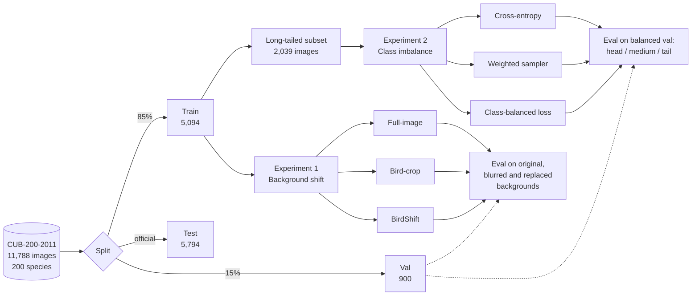

All six models share the same backbone (ImageNet-pretrained ResNet-50 with a 200-way head), optimiser (AdamW, lr 1e-4), batch size (64) and validation split (stratified, `random_state=42`).

---

## Best runs

Best checkpoint of each run, chosen by validation accuracy. "Val (training log)" is the number logged during training. "Val (re-evaluated)" comes from the evaluation scripts and is the number used in every results table.

| Run | Training data | Best epoch | Val (training log) | Val (re-evaluated) | Checkpoint |
|---|---|---|---|---|---|
| Full-image | 5,094 images | 30 / 30 | 78.33% | **78.33%** | `checkpoints/baseline/best.pth` |
| Bird-crop | 5,094 images | 24 / 25 | 77.89% | **77.89%** | `checkpoints/crop/best.pth` |
| BirdShift | 5,094 images | 29 / 30 | 78.33% | **78.22%** | `checkpoints/birdshift/best.pth` |
| Long-tail, standard CE | 2,039 images | 30 / 30 | 53.00% | **53.00%** | `checkpoints/longtail_ce/best.pth` |
| Long-tail, weighted sampler | 2,039 images | 30 / 30 | 59.89% | **59.78%** | `checkpoints/longtail_sampler/best.pth` |
| Long-tail, class-balanced CE | 2,039 images | 29 / 30 | 59.33% | **59.33%** | `checkpoints/longtail_cb/best.pth` |

The long-tail runs see 60% fewer training images than the first three, so their absolute accuracy should only be compared with each other.

### Training curves

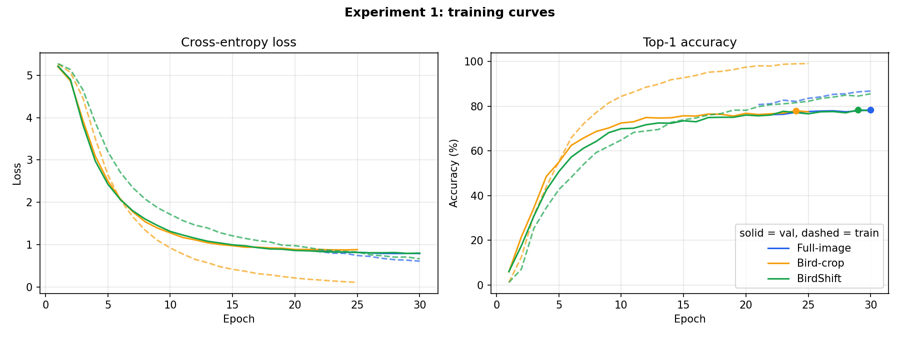

Dots mark the best validation epoch. The bird-crop model fits its training set almost perfectly (99% train accuracy, train loss near 0.1) while validation flattens at about 78%, so it overfits the most. BirdShift trains more slowly than the full-image model because half its training images have their background blurred, but it reaches the same validation accuracy. The full-image log only covers epochs 21 to 30 (see [problem 7](#problems-we-hit-and-how-we-fixed-them)).

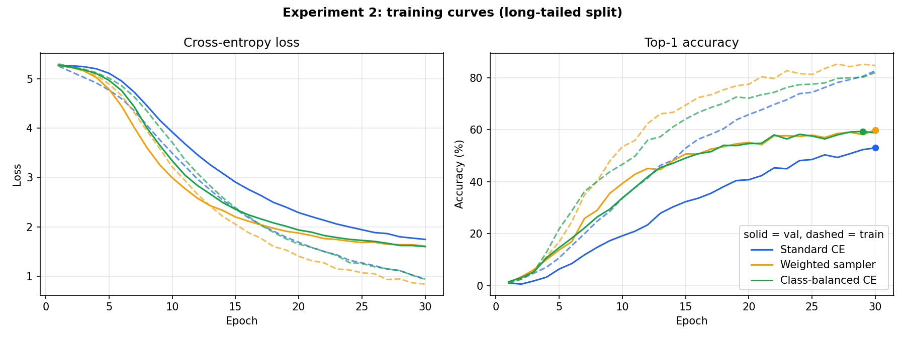

With only 2,039 images the gap between train and validation loss is much larger. Standard CE ends with the highest validation loss, while both balancing methods keep it lower and finish 6 to 7 points higher in accuracy.

---

## Experiment 1: background shift

### The three models

| Model | What it sees in training | What it sees at test time | Needs a bounding box at test time? |
|---|---|---|---|
| **Full-image** | Whole photo, `RandomResizedCrop` + flip | Whole photo, `Resize(256)` + `CenterCrop(224)` | No |
| **Bird-crop** | Bounding-box crop, square-padded, flip / rotate / colour jitter | Bounding-box crop | **Yes** |
| **BirdShift** | Whole photo; half the time the background is blurred first | Whole photo, same as full-image | No |

### How BirdShift training works

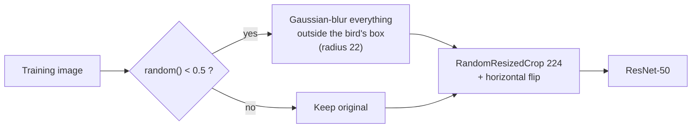

The bounding box is only used to build the training augmentation. At test time BirdShift takes a plain photo, exactly like the full-image model.

### How the test images are shifted

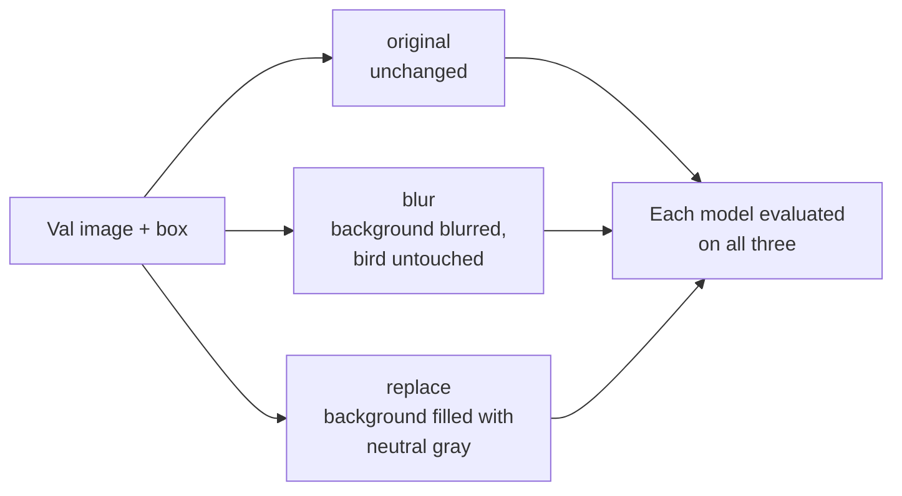

Gray is used for `replace` instead of another photo so that no second bird or species-specific habitat leaks into the image.

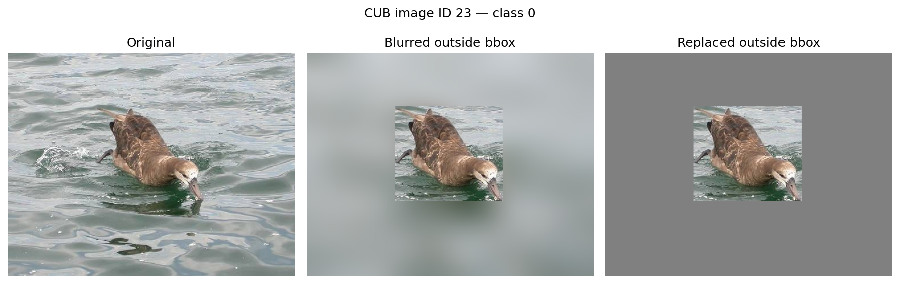

### Results

Top-1 accuracy on the 900 validation images:

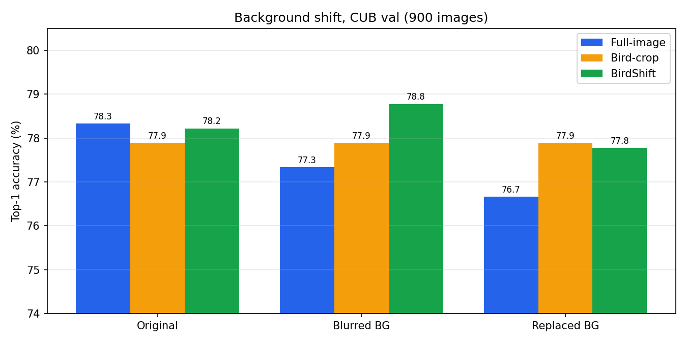

| Model | Original | Blurred BG | Replaced BG | Change (blur) | Change (replace) |
|---|---|---|---|---|---|
| Full-image | **78.33%** | 77.33% | 76.67% | −1.00 pp | −1.67 pp |
| Bird-crop | 77.89% | 77.89% | 77.89% | 0.00 pp | 0.00 pp |
| **BirdShift** | 78.22% | **78.78%** | **77.78%** | **+0.56 pp** | −0.44 pp |

<details>
<summary><b>Macro-F1 for the same runs</b></summary>

| Model | Original | Blurred BG | Replaced BG |
|---|---|---|---|
| Full-image | **0.776** | 0.765 | 0.758 |
| Bird-crop | 0.769 | 0.769 | 0.769 |
| BirdShift | 0.772 | **0.779** | **0.771** |

</details>

**Takeaways**

- The full-image model loses accuracy whenever its background is changed, so part of what it learned is the scene, not the bird.
- The bird-crop model can't be affected by the background because it never sees it. The price is that it needs a bounding box for every test image.
- BirdShift needs no box at test time, matches the full-image model on normal photos (−0.11 pp), and holds up better under both shifts.

These are controlled, synthetic shifts. They show the model leans less on background context; they don't yet show it generalises to new real-world habitats.

---

## Experiment 2: class imbalance

CUB is almost balanced (about 25 to 30 training images per species), so balancing methods would have little to fix on the original data. Instead the training split is cut down to an exponential long-tail with a 10:1 ratio between the most and least common class. The validation set stays balanced.

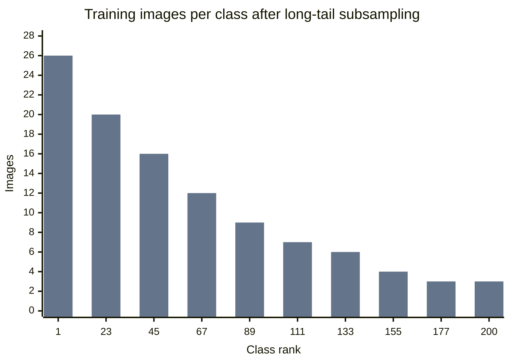

Class at rank *r* keeps `n_max · 10^(−r/199)` images (at least 1): 5,094 → 2,039 images, 26 down to 3 per class. The class order is a seeded random shuffle, because CUB labels are sorted by taxonomy and otherwise the "tail" would be a single bird family.

### The three methods

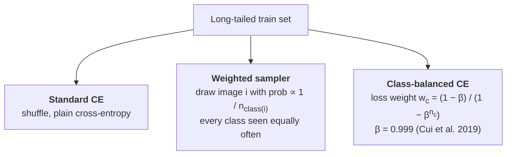

Head, medium and tail are the top, middle and bottom thirds of classes ranked by how many training images they kept.

### Results

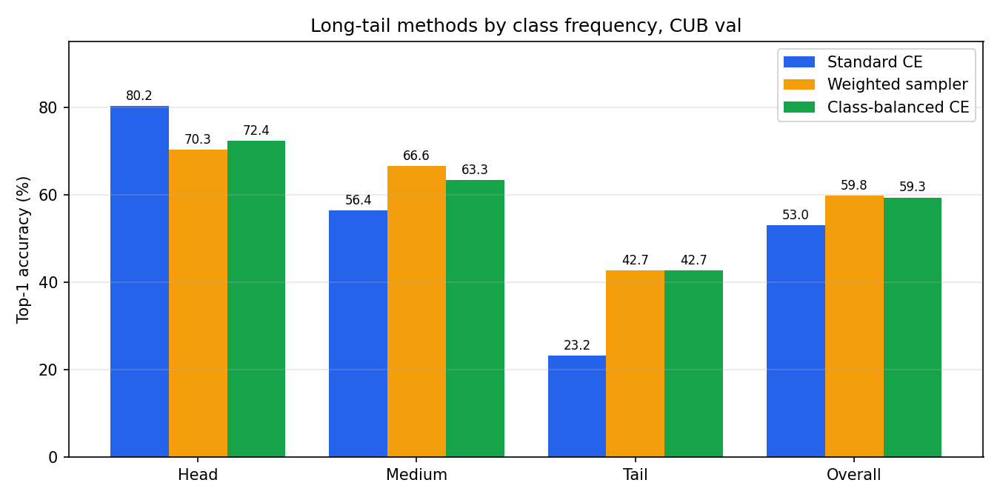

| Method | Top-1 | Macro-F1 | Head | Medium | Tail |
|---|---|---|---|---|---|
| Standard CE | 53.00% | 0.477 | **80.20%** | 56.39% | 23.18% |
| Weighted sampler | **59.78%** | **0.571** | 70.31% | **66.56%** | **42.72%** |
| Class-balanced CE | 59.33% | 0.563 | 72.35% | 63.28% | **42.72%** |

**Takeaways**

- Plain cross-entropy is good on common classes and poor on rare ones (80% vs 23%).
- Both balancing methods nearly double tail accuracy and add about 6.5 pp overall, at a cost of 8 to 10 pp on head classes.
- Sampler and class-balanced loss end up within 0.5 pp of each other (about 4 images), so this run doesn't separate them.

> **Caveat for both experiments.** Every number above comes from one training run (seed 42) on the 900-image validation split. A 1 pp gap is 9 images. Multi-seed runs, test-split numbers and paired significance tests are still to do. The official CUB test split has deliberately not been used yet, so it stays untouched until model selection is frozen.

---

## Problems we hit and how we fixed them

| # | Problem | How we noticed | Fix |
|---|---|---|---|
| 1 | **Bird-crop model stuck at 40% accuracy.** Bounding-box crops were resized straight to 224×224, which stretched tall and wide birds out of shape. | Crop model far below the full-image model (40.3% vs 78%). | Pad each crop to a square with gray (`SquarePad`) before resizing, and add flip / rotation / colour-jitter augmentation. Accuracy went 40.3% → 70.1% → **77.9%**. |
| 2 | **Two evaluation scripts could silently disagree.** `evaluate.py` and `evaluate_shift.py` build their inputs differently. | Needed to trust that "original" in the shift experiment equals normal evaluation. | `scripts/audit_evaluators.py` compares both pipelines image by image: 0 tensor mismatches, 0 prediction mismatches, identical 78.33%. Saved in `results/metrics/evaluation_audit.json`. |
| 3 | **Background replacement could leak information.** Pasting the bird onto another photo's background can bring in a second bird or a species-typical habitat. | Design review of the `replace` condition. | Replace the background with flat neutral gray instead of a donor image. |
| 4 | **BirdShift checkpoints written into the crop folder.** A leftover line in `train.py` sent every non-`full` run to `checkpoints/crop/`, so BirdShift overwrote `crop/last.pth`. | A checkpoint in `checkpoints/crop/` had `mode = birdshift` stored inside it. | Removed the override so each mode gets its own folder; recovered checkpoints moved to `checkpoints/recovery/`. The crop model's `best.pth` was never touched. |
| 5 | **`--suppression-prob` did nothing.** The flag was parsed but never passed to the dataset. | Reading `train.py` while checking the folder bug. | Passed through to `CUBDataset`. Existing results are unaffected because the dataset default was already 0.5. |
| 6 | **BirdShift model refused to load for evaluation.** The loader checks that a checkpoint's stored mode matches the requested one. BirdShift is stored as `birdshift` but is evaluated with full-image preprocessing. | `ValueError: Checkpoint mode='birdshift', requested mode='full'`. | `evaluate_shift.py` now keeps the model name (checked against the checkpoint) separate from the preprocessing mode. |
| 7 | **Baseline improved after more epochs, but early log lost.** The first full-image run stopped at epoch 20 (77.56%). | Validation accuracy still rising at epoch 20. | Resumed with `--resume` to epoch 30 (**78.33%**). Only epochs 21 to 30 of the log survived, which is why its curve starts at epoch 21. |
| 8 | **PyTorch crashed under the system Python.** | `A module that was compiled using NumPy 1.x cannot be run in NumPy 2.2.6`. | All work runs inside the project virtual environment (`.venv`). |
| 9 | **CUB is too balanced to test imbalance methods.** About 25 to 30 training images per species. | Balancing would have little to correct. | Built an exponential long-tail training split (10:1). Classes are shuffled with a fixed seed first, because CUB labels are sorted by taxonomy and the tail would otherwise be one bird family. |
| 10 | **Training log and evaluation differ by one image** (59.89% vs 59.78%, 78.33% vs 78.22%). | Comparing logs with evaluation output. | Most likely GPU nondeterminism (`cudnn.benchmark` is on during training) flipping one near-tie prediction. All results tables use the evaluation-script numbers. |

---

## Setup

```bash
python3 -m venv .venv && source .venv/bin/activate
pip install torch torchvision pandas scikit-learn pillow matplotlib
```

Tested with Python 3.10, PyTorch 2.14 (CUDA 13), torchvision 0.29 on an RTX 3090.

<details>
<summary><b>Download the dataset</b></summary>

CUB-200-2011 is available from the [Caltech data repository](https://data.caltech.edu/records/65de6-vp158). It is not tracked in git.

```bash
mkdir -p data/raw && cd data/raw
wget -O CUB_200_2011.tgz "https://data.caltech.edu/records/65de6-vp158/files/CUB_200_2011.tgz?download=1"
tar -xzf CUB_200_2011.tgz && cd ../..
```

Expected layout:

```
data/raw/CUB_200_2011/
├── images/
├── images.txt
├── image_class_labels.txt
├── train_test_split.txt
└── bounding_boxes.txt
```

</details>

---

## Running the code

Run everything from the repository root.

<details open>
<summary><b>Experiment 1: train and evaluate</b></summary>

```bash
PYTHONPATH=src python scripts/train.py --mode full      --epochs 30   # checkpoints/baseline/
PYTHONPATH=src python scripts/train.py --mode crop      --epochs 30   # checkpoints/crop/
PYTHONPATH=src python scripts/train.py --mode birdshift --epochs 30   # checkpoints/birdshift/

PYTHONPATH=src python scripts/evaluate_shift.py --split val           # results/background_shift/
```

</details>

<details open>
<summary><b>Experiment 2: train and evaluate</b></summary>

```bash
for b in none sampler cb; do
  PYTHONPATH=src python scripts/train.py --mode full --epochs 30 \
      --imbalance-ratio 10 --balance $b --run-name longtail_${b/none/ce}
done

PYTHONPATH=src python scripts/evaluate_longtail.py --split val        # results/longtail/
```

The three runs fit on one 24 GB GPU at the same time (about 20 s per epoch each).

</details>

<details>
<summary><b>All <code>train.py</code> options</b></summary>

| Flag | Default | Meaning |
|---|---|---|
| `--mode` | `full` | `full`, `crop` or `birdshift` |
| `--suppression-prob` | `0.5` | BirdShift: probability of blurring a training image's background |
| `--imbalance-ratio` | `1` | Long-tail training split, max/min class size (1 = original data) |
| `--balance` | `none` | `none` (cross-entropy), `sampler` (WeightedRandomSampler), `cb` (class-balanced loss) |
| `--cb-beta` | `0.999` | β for class-balanced loss |
| `--run-name` | by mode | Folder under `checkpoints/` and name of the training log |
| `--resume` | | Continue from a `last.pth`; `--epochs` is the total, not extra |
| `--epochs` | `20` | |
| `--batch-size` | `64` | |
| `--lr` | `1e-4` | |
| `--workers` | `4` | |

Each run writes `best.pth` (best val accuracy) and `last.pth` to `checkpoints/<run>/`, and a per-epoch log to `results/metrics/cub_<run>_training.csv`.

</details>

<details>
<summary><b>Figures, sanity checks and tests</b></summary>

```bash
PYTHONPATH=src python scripts/visualize_shift.py       # original / blur / replace triplets
PYTHONPATH=src python scripts/visualize_birdshift.py   # BirdShift training samples
PYTHONPATH=src python scripts/audit_evaluators.py      # evaluate.py and evaluate_shift.py agree

PYTHONPATH=src python tests/test_background.py         # bounding box is preserved by the shifts
PYTHONPATH=src python tests/test_longtail.py           # long-tail split is deterministic, val untouched
```

Use `--split test` on the evaluation scripts for the official test set (5,794 images). Settle every design choice on val first.

</details>

---

## Repository layout

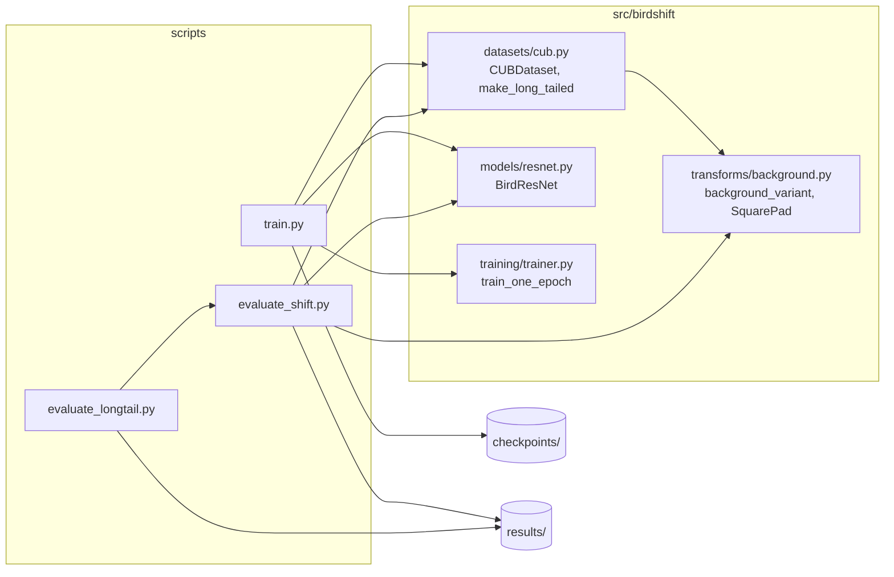

```
BirdShift/
├── src/birdshift/      library code (dataset, model, transforms, training loop)
├── scripts/            training, evaluation and visualisation entry points
├── tests/              runnable checks
├── results/            metrics, per-image predictions, figures
├── data/raw/           CUB-200-2011 (not in git)
└── checkpoints/        model weights, ~290 MB each (not in git)
```

---

## Roadmap

- [x] Full-image, bird-crop and BirdShift models
- [x] Controlled background-shift evaluation
- [x] Class-imbalance comparison: cross-entropy, weighted sampler, class-balanced loss
- [ ] Test-split numbers, multiple seeds, paired significance tests
- [ ] Geographic clustering of images
- [ ] Background clustering of images
- [ ] Train on some clusters, test on held-out clusters

## References

1. C. Wah, S. Branson, P. Welinder, P. Perona, S. Belongie. *The Caltech-UCSD Birds-200-2011 Dataset.* Caltech, 2011.
2. K. He, X. Zhang, S. Ren, J. Sun. *Deep Residual Learning for Image Recognition.* CVPR 2016.
3. Y. Cui, M. Jia, T.-Y. Lin, Y. Song, S. Belongie. *Class-Balanced Loss Based on Effective Number of Samples.* CVPR 2019.
4. K. Xiao, L. Engstrom, A. Ilyas, A. Madry. *Noise or Signal: The Role of Image Backgrounds in Object Recognition.* ICLR 2021.
