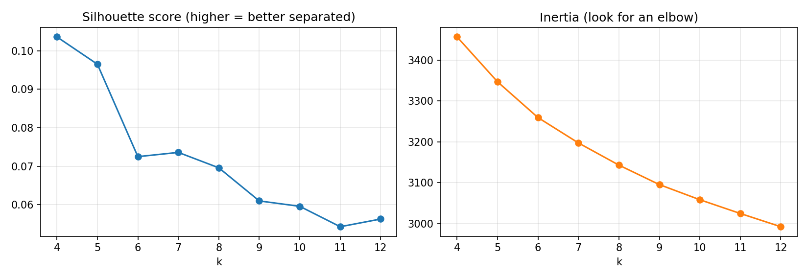
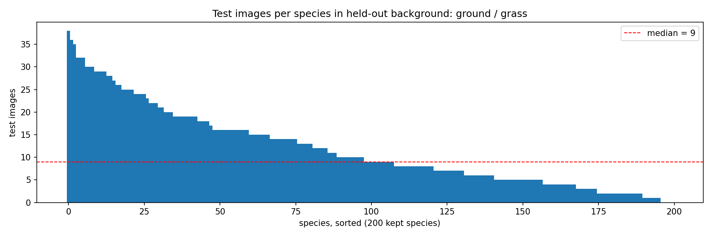

# Background-shift split (held-out background clusters)

Experiment B: train on some kinds of background, test on a kind of background **never seen in training**.
If a model relies on background shortcuts instead of bird features, its accuracy drops on this test set.

## Files

| File | Content |
|---|---|
| `background_clusters.csv` | manifest, one row per CUB image (11,788 rows) |
| `species_coverage.csv` | per-species image counts in train / val / test |
| `split_summary.json` | all numbers in this README, machine-readable |
| `cluster_centroids.npy` | the 5 cluster centroids (5 x 2048, L2-normalised); they define which cluster is which |

Manifest columns: `image_id,image_path,label,cluster_id,cluster_name,split` (as specified), plus
`bg_fraction` (share of the image left as background after masking the bird) and `species_dropped`
(1 = species has fewer than 10 training-cluster images, exclude it).

## How backgrounds were clustered

1. **Remove the bird.** The CUB bounding box (`bounding_boxes.txt`), enlarged by 5% per side, is filled with the ImageNet mean colour (124, 116, 104).
2. **Features.** torchvision ResNet-50 with ImageNet weights (`IMAGENET1K_V1`), penultimate layer (2048-d). The whole image is resized to 224x224 (no crop) so no background is lost. Script: `scripts/background/extract_features.py`.
3. **Clustering.** L2-normalised features, K-means with `n_init=10`, `random_state=42`. Script: `scripts/background/cluster_backgrounds.py`.
   The centroids are saved in `cluster_centroids.npy`, and later runs assign each image to the nearest saved centroid (see Reproduce).

## Choice of k

| k | silhouette | smallest cluster | largest cluster |
|---|---|---|---|
| 4 | 0.1036 | 1103 | 4776 |
| 5 | 0.0965 | 1032 | 4120 |
| 6 | 0.0725 | 1010 | 2732 |
| 7 | 0.0736 | 958 | 2551 |
| 8 | 0.0696 | 952 | 2182 |
| 9 | 0.0610 | 634 | 2121 |
| 10 | 0.0596 | 530 | 1991 |
| 11 | 0.0543 | 528 | 1464 |
| 12 | 0.0563 | 453 | 1418 |

Silhouette was highest at k = 4 (0.104) and k = 5 (0.097) and dropped sharply for k >= 6 (<= 0.074). We chose k = 5: it nearly matches the best silhouette and, on visual inspection, splits the large mixed ground/foliage cluster of k = 4 into two visually distinct scenes. Inertia decreases smoothly with no clear elbow, so it did not decide k.



## Clusters (k = 5)

| id | name | images | species | mean bg fraction | role | notes |
|---|---|---|---|---|---|---|
| 0 | ground / grass | 2,350 | 196 | 0.60 | test (held out) | mostly ground-level scenes (grass, gravel, rocks, snow, mud); a few plain-colour backdrops |
| 1 | dense foliage | 4,120 | 169 | 0.66 | train / val | birds perched on twigs/branches with leaves or blurred green behind; visually consistent |
| 2 | man-made / mixed perches | 2,829 | 199 | 0.58 | train / val | mixed: fences, posts, wires, walls, asphalt, buildings, hands |
| 3 | plain sky / blurred backdrop | 1,457 | 194 | 0.32 | train / val | mixed: flying birds against plain sky and close-ups with blurred backgrounds; the bird fills much of the frame |
| 4 | water | 1,032 | 70 | 0.66 | train / val | open water (calm or choppy) and shoreline; visually consistent |

Galleries (16 random images each): `results/figures/background_clusters/cluster_<id>.png`. 2-D map: `embedding.png`.

## Held-out test background

**Cluster(s) 0 (ground / grass).** It is a visually consistent background (ground, grass, rocks, snow) that differs clearly from the training backgrounds, and it is the only clean option that drops no species: all 200 species keep at least 10 training images, 196 species appear in the test set (2,350 images). Holding out water instead would drop 5 species and leave only 65 species in the test set.

All held-out images are `test`. `val` is a random 15% of the training-cluster images,
stratified by species, so the held-out background is never used for checkpoint selection or tuning.

## Split sizes

Kept species only (`species_dropped == 0`), which is what experiments should use:

| split | images | species |
|---|---|---|
| train | 8,015 | 200 |
| val | 1,423 | 200 |
| test | 2,350 | 196 |

All rows, including dropped species:

| split | images | species |
|---|---|---|
| train | 8,015 | 200 |
| val | 1,423 | 200 |
| test | 2,350 | 196 |

## Species coverage

- 200 of 200 species have at least 10 images in the training clusters and are kept.
- Dropped species: None.
- Full per-species table: `species_coverage.csv`.

## Species imbalance inside the held-out background

Test images per kept species: min 0, median 9, max 38.
Species with 0 test images: 4; 1-4: 39; 5-9: 59; 10 or more: 98.

- Most test images: Horned_Lark (38), American_Pipit (36), Geococcyx (35), Bronzed_Cowbird (32), Baird_Sparrow (32)
- Fewest test images: Hooded_Merganser (1), Eared_Grebe (0), Western_Grebe (0), Pacific_Loon (0), Chestnut_sided_Warbler (0)

This is expected: species are photographed in typical habitats, so some are almost absent from the held-out background.
Report per-class (balanced) accuracy alongside overall accuracy, and treat per-species results with few test images with caution.



## Limitations

- The gray box hides the bird but also some background around it; birds that fill the frame leave little background (see `bg_fraction`).
- Clusters are not perfectly pure (natural photos mix scenes). Clusters 2 and 3 are mixed and are used for training only.
- ImageNet features capture colour, texture and blur as well as scene type, so clusters partly reflect photographic style.
- Clusters also partly reflect how much of the frame the gray box covers: cluster 3 has a mean background fraction of 0.32,
  against 0.58 to 0.66 for the others, so it is partly a "close-up" cluster. The held-out cluster 0 (0.60) is in line with the training clusters.
- The split ignores CUB's official train/test split: about half of the held-out test images are in the official CUB training set.
  Models trained on the standard CUB split (everything in `checkpoints/` so far) have seen them, so they must be retrained on
  this split before being evaluated on it.
- 43 species have fewer than 5 test images (4 have none), so per-species test accuracy is noisy; report balanced accuracy
  over species with at least 5 test images next to overall accuracy.

## Usage

```python
import pandas as pd
df = pd.read_csv("data/splits/background/background_clusters.csv")
df = df[df.species_dropped == 0]
train, val, test = (df[df.split == s] for s in ["train", "val", "test"])
```

## Reproduce

```bash
python scripts/background/extract_features.py      # CUB in data/raw/CUB_200_2011, features to data/processed
python scripts/background/cluster_backgrounds.py   # add --sweep for the k = 4..12 sweep, --embedding for t-SNE
```
**The committed `background_clusters.csv` is the split; use it for experiments.** Rerunning reproduces it closely but not
bit for bit:

- K-means numbers its clusters arbitrarily, and small feature differences between machines (GPU, library versions)
  permute the ids. A plain refit on another machine swapped clusters 2, 3 and 4, which would have silently renamed
  "water" as "man-made" (and could move the held-out cluster). The script therefore assigns each image to the nearest
  centroid in `cluster_centroids.npy` by default; `--refit` re-runs K-means and renumbers its clusters to match the
  saved centroids.
- Re-extracting features on a different GPU and assigning to the saved centroids put 99.1% of images in the same cluster
  (test set 2,348 vs 2,350 images). The val draw is per species, so a species with even one moved image gets a new
  val sample.
